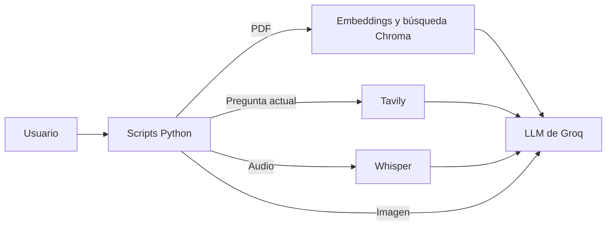

# Taller de herramientas, RAG y modelos multimodales

Proyecto educativo con ejemplos en Python para explorar cómo un modelo de lenguaje puede usar herramientas, consultar documentos y procesar entradas de texto, imágenes y audio. Incluye un asistente RAG que responde preguntas sobre reglamentos en PDF, una búsqueda web con Tavily y ejercicios multimodales con capturas de Nintendo Switch 2.

## Propósito y arquitectura

El proyecto muestra, mediante scripts independientes, distintas formas de conectar un LLM de Groq con herramientas de LangChain. En los ejemplos RAG, los PDF se cargan localmente, se convierten en embeddings y se consultan en Chroma; el LLM redacta la respuesta con los fragmentos recuperados. La búsqueda web usa Tavily. El flujo de audio transcribe con Whisper antes de enviar el texto al LLM.

**Objetivo:** practicar integración de LLM con herramientas, RAG y entradas multimodales. Entre los ejemplos están el cálculo con una herramienta, preguntas sobre reglamentos PDF, búsqueda web, análisis de capturas y preguntas por voz.



## Estructura

Los ejemplos ejecutables están en la raíz (`tools.py`, `rag_*.py`, `web_search*.py`, `multimodal.py` y `audio_input.py`). Las funciones compartidas están en `utils/`; `pdfs/` y `imagenes/` contienen entradas de ejemplo.

## Requisitos y configuración

- Python y las dependencias de [requirements.txt](./requirements.txt).
- Una clave de Groq para los ejemplos que usan modelos.
- PDF en `pdfs/` para los ejemplos RAG y capturas PNG/JPEG en `imagenes/` para el análisis visual.
- Micrófono para `audio_input.py`.
- Una clave de Tavily para `web_search_2.py` y para búsquedas solicitadas durante `audio_input.py`.

Instala las dependencias desde la raíz del proyecto:

```powershell
python -m venv .venv
.\.venv\Scripts\Activate.ps1
pip install -r requirements.txt
```

Crea un archivo `.env` en la raíz y configura las variables necesarias. Las claves son secretas; no las publiques ni subas el archivo al repositorio.

```env
GROQ_API_KEY=
TAVILY_API_KEY=

# Opcionales: si se omiten, el código usa sus valores predeterminados.
LLM_MODEL=openai/gpt-oss-20b
VISION_MODEL=qwen/qwen3.8-27b
EMBEDDINGS_MODEL=BAAI/bge-base-en-v1.5
PERSIST_DIR=./db
```

`GROQ_API_KEY` es necesaria para llamar a Groq. `TAVILY_API_KEY` se requiere en los ejemplos de búsqueda web. `LLM_MODEL` debe admitir *tool calling* en los scripts que usan herramientas; `VISION_MODEL`, `EMBEDDINGS_MODEL` y `PERSIST_DIR` permiten cambiar valores que ya tienen predeterminados.

## Ejecución

Ejecuta cada comando desde la raíz del proyecto. Los scripts son demostraciones independientes:

| Comando | Qué hace |
|---|---|
| `python tools.py` | Ejemplo de herramienta para calcular una nota. |
| `python rag_basico.py` | RAG que crea la base vectorial desde los PDF y permite preguntar sobre ellos. |
| `python rag_con_tools.py` | RAG que ofrece la búsqueda de reglamentos como herramienta del LLM. |
| `python web_search.py` | Ejemplo de respuesta del modelo sin búsqueda web. |
| `python web_search_2.py` | Ejemplo de búsqueda web con Tavily y una pregunta definida en el script. |
| `python multimodal.py` | Selecciona una captura y consulta información visible. |
| `python multimodal.py --extraer` | Extrae y compara campos de 2 o 3 capturas; requiere completar `ground_truth_switch_2.json`. |
| `python audio_input.py` | Graba audio, lo transcribe con Whisper y responde; usa Tavily si el modelo solicita búsqueda. |

En los scripts RAG, escribe `salir` para terminar. Si la carpeta `db/` no existe, `rag_con_tools.py` la crea a partir de los PDF. `rag_basico.py` vuelve a crear la base al iniciar.

## Tecnologías y aspectos técnicos

Python, LangChain, Groq, Whisper, Tavily, Hugging Face Embeddings, Chroma y JSON Schema. Se practican *tool calling*, RAG, búsqueda semántica, transcripción de voz, entrada de imágenes y validación de datos estructurados.

## Estado y seguridad

Proyecto educativo con ejemplos ejecutables; requiere claves de API y, según el script, archivos PDF, imágenes o acceso al micrófono. Mantén las claves en `.env` y no las incluyas en el código ni en el repositorio. No se documenta una licencia porque no hay una definida en el proyecto.

## Autores

**Ruzky**
- **Julian Arley Ruiz Gonzalez**
- **Luna Anahy Chaparro Bustos**
